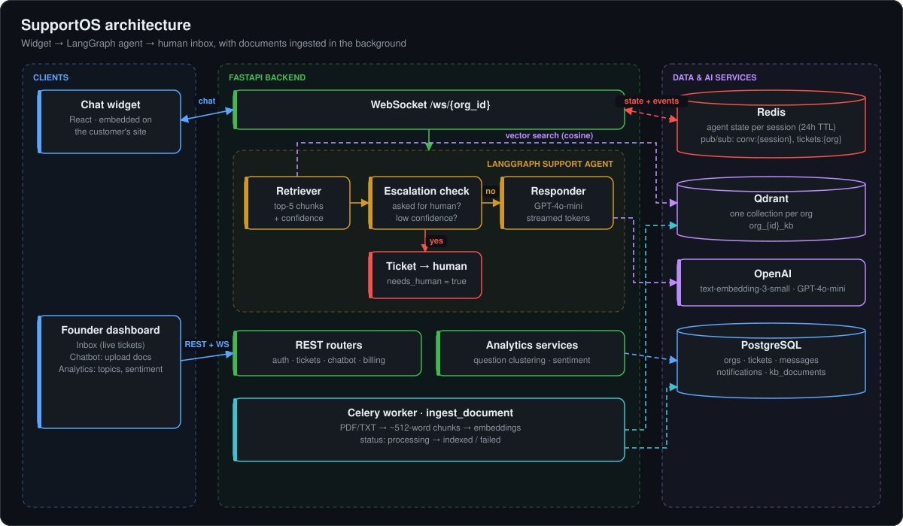

# SupportOS

**AI customer support for 0 to 20 person startups.** Drop a chat widget on your site and customers get instant answers from your own docs. Anything the bot can't resolve escalates to your inbox with the full conversation attached.



## The problem

A small team answers the same questions all day and has no time to build a support operation. SupportOS answers what your documentation already covers and hands off the rest to a human with context, so customers never repeat themselves.

## How it works

1. A customer opens the **chat widget** and talks to the backend over a WebSocket.
2. A **LangGraph agent** retrieves the five most relevant chunks of that company's docs from Qdrant, checks whether it should hand off, and otherwise answers with GPT-4o-mini, streaming tokens back.
3. If it escalates, the conversation becomes a **ticket flagged `needs_human`** and appears in the founder's inbox in real time.
4. Founders upload docs in the dashboard. A **Celery worker** chunks, embeds and indexes them in the background.

## Key design decisions

- **Escalation is rule-based, not left to the LLM.** The agent hands off when the customer asks for a human, when retrieval confidence is below 0.3 after a previous failed answer, or after two consecutive "I don't know" replies. It is predictable and easy to test; the tradeoff is that the keyword list needs maintenance.
- **Each company gets its own Qdrant collection** (`org_{id}_kb`). Tenant isolation comes from the storage layout instead of a filter that could be forgotten, at the cost of managing more collections.
- **Redis holds conversation state and fans out events.** Agent state is stored per session with a 24 hour TTL, so the WebSocket handler stays stateless, and pub/sub channels (`conv:{session}`, `tickets:{org}`) push messages to the widget and the inbox.
- **Slow work stays off the request path.** Document ingestion runs in Celery (the UI polls status: processing → indexed or failed), and sentiment scoring is batched when the analytics page loads instead of adding an LLM call to every chat turn.

## Features

- Embeddable chat widget with streaming answers
- Live inbox with notifications for escalated tickets
- Knowledge-base management: upload PDF or TXT, track indexing status
- Analytics: embedding-based question clustering and sentiment scoring
- Auth, billing and organisation settings, with Alembic migrations

## Tech stack

FastAPI · React 18 · Vite · Tailwind · LangGraph · OpenAI · PostgreSQL · Qdrant · Redis · Celery · Docker

## Run locally

```bash
docker-compose up -d                 # Postgres (Redis and Qdrant use cloud URLs from .env)
cp .env.example .env                 # set OPENAI_API_KEY, AUTH_SECRET, DATABASE_URL, REDIS_URL, QDRANT_URL

cd backend
pip install -r requirements.txt
alembic upgrade head
uvicorn main:app --reload            # API on :8000, docs at /docs
celery -A workers.celery_app worker --loglevel=info   # document ingestion (separate terminal)

cd ../frontend
npm install && npm run dev           # app on :5173
```

## Repository layout

```
agents/      LangGraph agent notes
backend/     FastAPI app: routers, services, models, migrations, Celery workers
  agents/    support agent graph (retriever → escalation check → responder)
frontend/    React app: landing page, dashboard, embeddable widget
scripts/     dev and seed utilities
```
